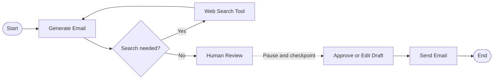

# AI Email Agent with Human Approval

A small LangGraph-powered email agent that creates context-aware email drafts and keeps a human in control before anything is sent.

## What It Does

- Generates an email from a recipient, subject, and requested tone.
- Uses web search when the topic needs current or factual information.
- Pauses after drafting so a human can review or edit the message.
- Resumes from the saved checkpoint and sends only the approved draft.
- Keeps each request isolated through a unique conversation thread.

## AI Graph Architecture

The model decides whether research is necessary while drafting. Tool results return to the model for another generation step. Once the draft is ready, LangGraph interrupts execution and stores the state in SQLite. Approval resumes the same thread, passes the reviewed draft to the SMTP sender, and completes the graph.

## API Flow

1. `POST /generate_email` starts a thread and returns a draft for review.
2. `POST /approve_email` resumes that thread with the approved or edited draft and sends it.

No email is sent during the generation step.
